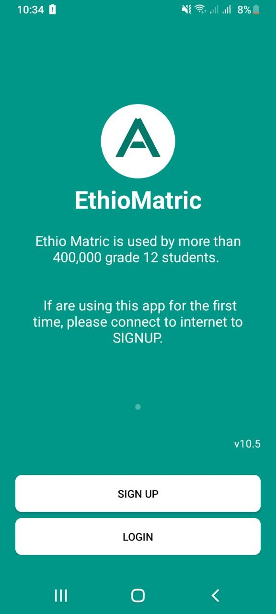
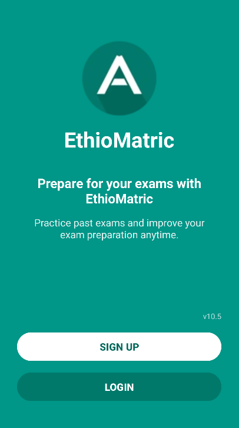
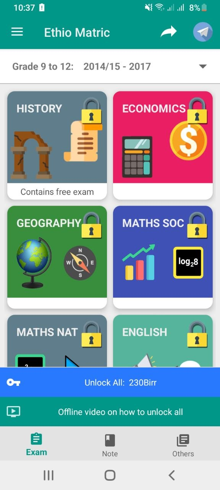
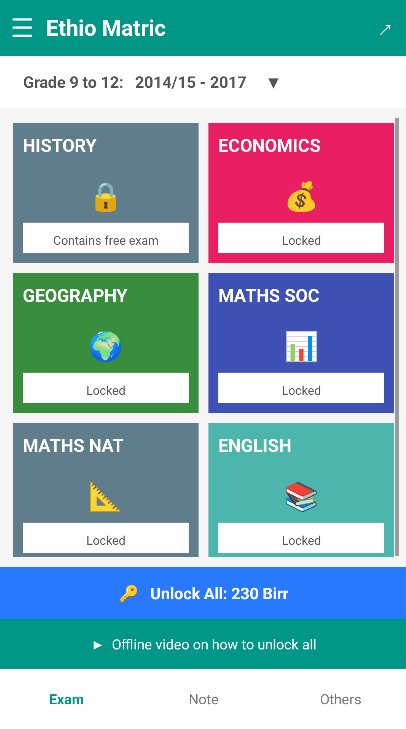

# EthioMatric Critique

## 1. Real EthioMatric App

### Welcome Screen

- **Logo and app name:** The logo and app name appear in the upper part of the screen. Their positioning and spacing could be better balanced with the other elements.
- **SIGN UP and LOGIN buttons:** These are the main actions on the screen, but their presentation could be clearer and more visually balanced to help new users understand their choices.
- **Overall layout:** The elements need more consistent spacing and alignment to maintain a good visual balance on different phone sizes.

##

  
  

### Home Screen

- **Subject cards:** The two-column subject grid uses large cards that occupy considerable vertical space. As a result, fewer subjects are visible at once, requiring students to scroll more.
- **Subject icons:** The icons take up too much space compared with the subject names. Reducing their size would make the cards more compact.
- **Subject names:** The labels should remain readable and consistently positioned when the card dimensions are reduced.
- **Screen space:** Shorter cards and consistent spacing would allow students to see more subjects without unnecessary scrolling.

##

  
  

## 2. Previous Student's Redesign

The previous student's redesign represents the main application flow, but some screens have specific UI issues:

- **Language Selection Screen:** The language prompt and English option need clearer visual hierarchy and better alignment.
- **Registration Screen:** The phone number, password, and name fields need consistent widths, spacing, and alignment.
- **Login Screen:** The phone number and password fields should be visually grouped with the Continue and Forgot Password actions.
- **Grade Selection Screens:** The Grade 9–12 and Social/Natural options should have consistent card sizes and alignment.

Across the redesign, icons are oversized, spacing and positioning are inconsistent, and color usage is not well balanced. These issues make the screens feel less like parts of one consistent application.

The redesign mainly reproduces the existing application flow instead of introducing meaningful improvements to the user experience.

## 3. Comparison and Improvement Opportunity

The previous student's redesign does not fully solve the usability and visual problems identified in the real application. It also introduces additional inconsistencies.

My redesign focuses on two screens:

- **Welcome Screen:** Improve the positioning of the logo, text, and SIGN UP and LOGIN buttons to create better spacing, alignment, and visual hierarchy.
- **Home Screen:** Preserve the familiar colorful subject cards while reducing icon sizes and card heights. This will make better use of screen space and reduce unnecessary scrolling.

The goal is to maintain EthioMatric's recognizable visual identity while making the interface cleaner, more consistent, and easier to use.