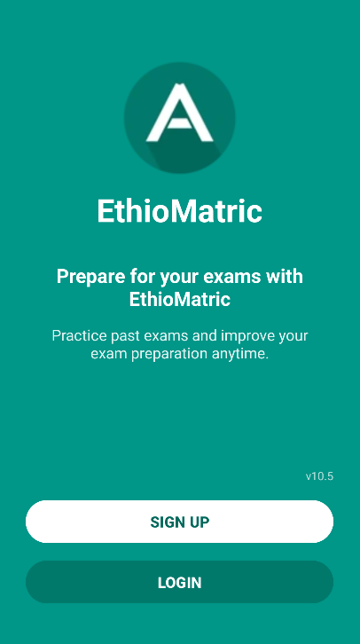
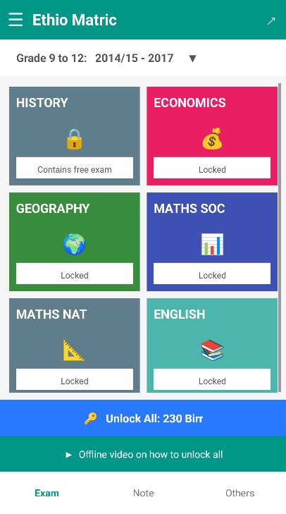

# EthioMatric Redesign Proposal

## 1. The Problem

The real EthioMatric app has two areas that need improvement.

- **Welcome Screen:** The layout can be improved through better spacing, alignment, and visual hierarchy to create a clearer and more welcoming first impression.
- **Home Screen:** Subject cards and icons are too large, occupying unnecessary screen space and requiring students to scroll more to find subjects.

The previous student's redesign also has UI inconsistencies, including oversized icons, poor alignment, inconsistent spacing, and unbalanced color usage.

## 2. Proposed Solution

I propose redesigning the Welcome and Home screens while keeping the familiar EthioMatric visual identity.

**Welcome Screen:**
- Improve logo and text positioning.
- Create better spacing and visual hierarchy.
- Make SIGN UP and LOGIN actions clear and consistent.
- Maintain the recognizable teal background.

##

  
  

**Home Screen:**
- Keep the original colorful subject cards.
- Reduce icon sizes and card heights.
- Use consistent spacing and alignment.
- Make better use of screen space.
- Maintain readable subject names and accessible touch areas.

##

  

## 3. Expected Impact

**UI Improvements:**
- Cleaner and more consistent interface.
- Better visual hierarchy, spacing, and alignment.
- More balanced use of colors.

**UX Improvements:**
- Better first impression for new users.
- Clearer entry actions.
- More subjects visible on the home screen.
- Less unnecessary scrolling.
- Easier subject discovery.

## 4. Scope

This project focuses on two screens:

1. **Welcome Screen:** Improve the first screen users see when opening the app.
2. **Home Screen:** Improve subject organization and screen-space usage.

The goal is to preserve EthioMatric's familiar design while making the interface cleaner, more consistent, and easier to use.